# Browser control with small Liquid models

I train small [Liquid AI](https://huggingface.co/LiquidAI) models, [LFM3-VL-2B](https://huggingface.co/LiquidAI/LFM3-VL-2B),
[LFM3-1.7B](https://huggingface.co/LiquidAI/LFM3-1.7B) and [LFM2-350M](https://huggingface.co/LiquidAI/LFM2-350M), to operate a
real browser through [MiniWoB++](https://miniwob.farama.org/) tasks in [BrowserGym](https://github.com/ServiceNow/BrowserGym),
on the free T4 GPUs of [Google Colab](https://colab.research.google.com/) and [Kaggle](https://www.kaggle.com/). Each turn the model sees the page, as a screenshot or as text, and emits one action toward
completing the task. Success is decided by the reward that each MiniWoB++ task computes itself.

Try the [live demo: base versus tuned models](https://huggingface.co/spaces/Aptheos/browser-control-live) on a task seed
you choose, or inspect the [recorded evaluation replays](https://huggingface.co/spaces/Aptheos/browser-control-demo).

- **From pixels alone**, [LFM3-VL-2B tuned with SFT, then GRPO](https://huggingface.co/Aptheos/lfm3-vl-2b-click-sequence-sft)
  clicks through a two-button sequence on **92 of 100** held-out tasks greedy and **83 of 100** sampled at temperature 1;
  the base model completed 0/100 tasks on the initial cohort under the reported evaluation settings. Adding GRPO to the SFT adapter raised sampled success from **26/100 to 83/100 on the same fresh tasks**;
  greedy success on those tasks was **91/100 before GRPO and 92/100 after it**.
- **From the page's text**, an [SFT-trained LoRA adapter for LFM3-1.7B](https://huggingface.co/Aptheos/lfm3-1.7b-book-flight-sft) books the right flight on **160 of 200** held-out ten-step tasks; the
  base model completed 0/100 tasks on a separate cohort under the reported one-call-per-turn settings.
- **With reinforcement learning using GRPO only**, [LFM2-350M](https://huggingface.co/Aptheos/lfm2-350m-click-test-grpo) goes from 2/50 to 50/50 on its first browser task.

## Links

| What | Where |
| --- | --- |
| Vision adapters: click-sequence SFT, SFT then GRPO, and click-color | [`Aptheos/lfm3-vl-2b-click-sequence-sft`](https://huggingface.co/Aptheos/lfm3-vl-2b-click-sequence-sft) |
| Book-flight adapter and its replica | [`Aptheos/lfm3-1.7b-book-flight-sft`](https://huggingface.co/Aptheos/lfm3-1.7b-book-flight-sft) |
| Click-test GRPO adapters, three seeds | [`Aptheos/lfm2-350m-click-test-grpo`](https://huggingface.co/Aptheos/lfm2-350m-click-test-grpo) |
| Every evaluation episode, screenshot and training record | [`Aptheos/lfm-browser-control-evidence`](https://huggingface.co/datasets/Aptheos/lfm-browser-control-evidence) |
| Replays to step through, and a narrated tour | [Space: `browser-control-demo`](https://huggingface.co/spaces/Aptheos/browser-control-demo) |
| Base and tuned models live on a task you choose | [Space: `browser-control-live`](https://huggingface.co/spaces/Aptheos/browser-control-live) |
| Base models | [LFM3-VL-2B](https://huggingface.co/LiquidAI/LFM3-VL-2B), [LFM3-1.7B](https://huggingface.co/LiquidAI/LFM3-1.7B), [LFM2-350M](https://huggingface.co/LiquidAI/LFM2-350M) |
| Environment | [MiniWoB++](https://miniwob.farama.org/), [BrowserGym](https://github.com/ServiceNow/BrowserGym) |

## How it works

<p align="center">
  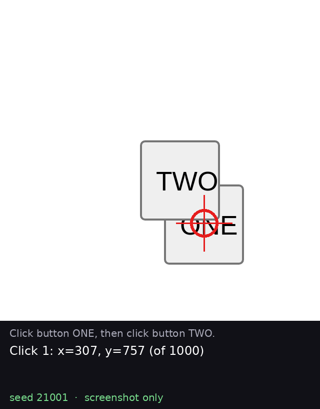
</p>

Above, the [SFT-trained vision adapter](https://huggingface.co/Aptheos/lfm3-vl-2b-click-sequence-sft) performs
[MiniWoB++](https://miniwob.farama.org/)'s [`click-button-sequence`](https://miniwob.farama.org/environments/click-button-sequence/)
on [held-out seed 21001](https://huggingface.co/spaces/Aptheos/browser-control-demo?task=21001).
The model receives a screenshot and the task instruction, without a DOM representation or element IDs. At each turn,
the model is prompted to output one click position. BrowserGym executes a valid click. The next model input contains
the updated screenshot and a text record of earlier click coordinates. The red ring marks each click location. The
buttons overlap in this layout, so the first click targets the visible portion of ONE, followed by a click on TWO.

The text models work the same way but read the page's accessibility tree instead of pixels, and write one tool call,
such as `fill` a field or `click` an element by its id. [BrowserGym](https://github.com/ServiceNow/BrowserGym) executes it in a real [Chromium](https://www.chromium.org/)
page, and [MiniWoB++](https://miniwob.farama.org/)'s own reward says whether the task
succeeded. No judge model is involved.

<p align="center">
  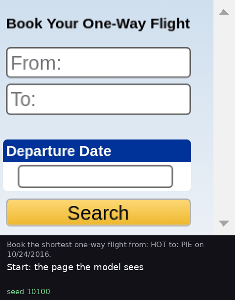
</p>

Above, the SFT adapter books the shortest flight on [reserved task 10100](https://huggingface.co/spaces/Aptheos/browser-control-demo?task=10100): two autocompletes, a date picker, a search,
then the shortest of three flights. Below, LFM2-350M on [`click-test`](https://miniwob.farama.org/environments/click-test/), before and after GRPO: the base model writes
something close to an action that the parser can't execute; the trained one writes `click('13')`.

| Base LFM2-350M | After GRPO |
| --- | --- |
| 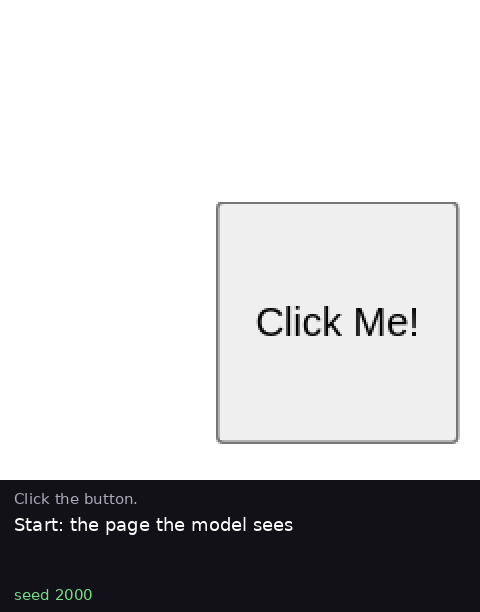 |  |

These are replays, not screen recordings of a live run. MiniWoB tasks are seeded, so resetting a task and applying the
actions the model recorded during evaluation redraws exactly what it did; a replay that doesn't reach the recorded
reward fails. `scripts/render_episode_replay.py` makes them from the evaluation reports. You can step through more
episodes, including failures, and watch a narrated two-minute tour in the
[Space](https://huggingface.co/spaces/Aptheos/browser-control-demo).

## What the model sees and writes

[MiniWoB++](https://miniwob.farama.org/) is a set of more than a hundred small web pages, each with an instruction and its
own scorer: "click the button", "book the shortest flight", "click the cyan box". A task is generated from a seed, so
seed 10100 always produces the same airports, dates and flights. When an episode ends, the task's scorer returns a reward:
1 for success, 0 for failure. [BrowserGym](https://github.com/ServiceNow/BrowserGym) runs these pages in a real browser
and turns each one into a turn-by-turn exchange with a model.

The model never touches the browser directly. Each turn it receives the instruction and a description of the page, and
it must answer with exactly one action in the required format. A strict parser reads that action; any other answer
ends the episode with reward 0, whether it's an explanation, two actions, or a call that's almost right. Nothing is
repaired or retried.

**What it sees.** For the text models, the page arrives as an accessibility tree: the page's elements, one per line, each
interactive one with an id. On the left is the page as a person sees it; on the right, the whole of what the text model
receives.

<table>
<tr><th><a href="https://miniwob.farama.org/environments/click-test/"><code>click-test</code></a>: the page</th><th>What the model receives</th></tr>
<tr><td>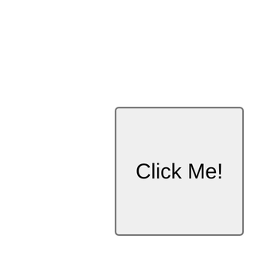</td>
<td><pre>Goal: Click the button.
RootWebArea 'Click Test Task', focused
	[13] button 'Click Me!'</pre></td></tr>
<tr><th><a href="https://miniwob.farama.org/environments/book-flight/"><code>book-flight</code></a>: the page</th><th>What the model receives (first lines)</th></tr>
<tr><td></td>
<td><pre>Goal: Book the shortest one-way flight from: HOT to: PIE on 10/24/2016.
	[17] heading 'Book Your One-Way Flight'
	[19] textbox 'From:'
	[21] textbox 'To:'
	StaticText 'Departure Date'
	[25] textbox ''
	[27] button 'Search'</pre></td></tr>
</table>

The vision model receives a screenshot rather than an accessibility tree, along with the task instruction and, on
subsequent turns, a text record of earlier click coordinates. Click positions use coordinates from 0 to 1000 on each
axis across the whole screenshot, as below. The first click on held-out seed 21001 lands on the visible part of ONE.

<p align="center">
  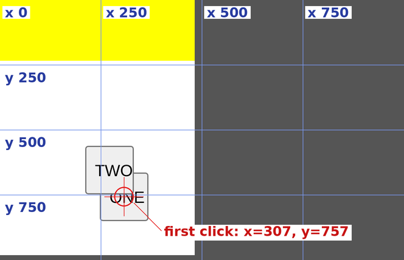
</p>

**What it writes.** On `click-test` the whole correct answer is `click('13')`. On `book-flight`, LFM3 answers in its own
tool-calling format, one call per turn, and needs about ten turns: type the origin, pick it from the autocomplete list,
do the same for the destination, open the date picker, page to the right month, pick the day, search, then compare the
flights and book the right one. The first turn of the episode above, and what it does to the page:

<table>
<tr><th>The model's first answer</th><th>The page afterwards</th></tr>
<tr><td><pre>&lt;tool_call&gt;
&lt;function=fill&gt;
&lt;parameter=bid&gt;
19
&lt;/parameter&gt;
&lt;parameter=value&gt;
HOT
&lt;/parameter&gt;
&lt;/function&gt;
&lt;/tool_call&gt;</pre>
It fills element 19, the <code>From:</code> box, with <code>HOT</code>; the page opens its autocomplete list, and the next
turn picks the airport from it.</td>
<td>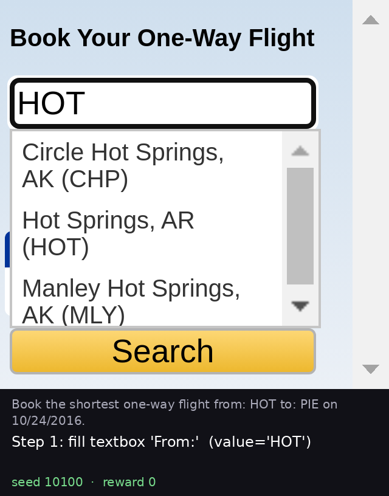</td></tr>
</table>

**Output formatting on `click-test`.** This task uses one fixed prompt and requires no multi-step reasoning. The page
contains a single button with ID `13`; the expected response is `click('13')`, which also appears in the prompt as an
example of the action format. Under this output contract, base LFM2-350M completed the task in 2 of 50 sampled responses.
Other responses included `click('Click Test Task')`, using the page title in place of the element ID, and
`click(<button id="13">Click Me!</button>)`, placing the button's HTML inside the call. After GRPO, the model returned
`click('13')` in 50 of 50 samples for each of three training seeds. `book-flight` extends the evaluation to a sequence
of tool calls and a flight-selection decision.

## Results

| Model | Task | Method | Result |
| --- | --- | --- | --- |
| LFM3-VL-2B | [`click-button-sequence`](https://miniwob.farama.org/environments/click-button-sequence/), screenshots only, unseen tasks | Base model, initial evaluation cohort | 0/100 |
| LFM3-VL-2B | [`click-button-sequence`](https://miniwob.farama.org/environments/click-button-sequence/), screenshots only, unseen tasks | SFT on 234 expert clicks | **95/100 greedy** (95% CI 89–98%); 21/100 sampled at temperature 1 |
| LFM3-VL-2B | [`click-button-sequence`](https://miniwob.farama.org/environments/click-button-sequence/), fresh unseen tasks | SFT, then GRPO on native reward | **92/100 greedy**, **83/100 sampled** (SFT on the same tasks: 91 and 26) |
| LFM3-VL-2B | [`click-color`](https://miniwob.farama.org/environments/click-color/), screenshots only, unseen tasks | Base, then SFT | 30/100 → 100/100 sampled, mostly a format fix (see below) |
| LFM3-1.7B | [`book-flight`](https://miniwob.farama.org/environments/book-flight/), multi-step, unseen tasks | Base model, one call per turn, thinking off, 128 tokens | 0/100 |
| LFM3-1.7B | [`book-flight`](https://miniwob.farama.org/environments/book-flight/), multi-step, unseen tasks | Supervised fine-tuning (SFT) on scripted expert traces | **160/200, 80.0%** (95% CI 73.9–85.0%) |
| LFM3-1.7B | [`book-flight`](https://miniwob.farama.org/environments/book-flight/), GRPO on top of SFT | Native reward | No detectable effect, and too little variation to continue |
| LFM2-350M | [`click-test`](https://miniwob.farama.org/environments/click-test/), one fixed prompt | GRPO, 3 seeds | 2/50 → 50/50 for each seed |

The vision SFT-only and SFT+GRPO evaluations above use different reserved cohorts.
The earlier **95/100 greedy** result is not the baseline for **83/100 sampled**.
On the fresh GRPO comparison cohort, the matched results are **26→83/100 sampled**
and **91→92/100 greedy**, comparing SFT with SFT followed by GRPO.
All baseline counts describe observations under the reported evaluation harness. The vision base model was evaluated
on the initial 100-task cohort. The book-flight base model and SFT adapter were evaluated on separate cohorts of
100 and 200 tasks, respectively, rather than a paired task set.

All of it fits a free Colab or Kaggle T4. The LFM3 reserved evaluation took about 1.6 hours for 200 episodes, including setup. Every
"unseen tasks" number comes from a reserved seed range evaluated once, after the protocol, policy and decoder were locked.

### LFM3-VL-2B: clicking a sequence from pixels

The vision model receives a screenshot and the instruction "Click button ONE, then click button TWO," without a DOM
representation or element IDs. At each turn, the model is prompted to output one click position, using coordinates
from 0 to 1000 on each axis. BrowserGym executes a valid click. The next model input contains the updated screenshot
and a text record of earlier click coordinates. The two buttons can appear anywhere on the page and may overlap.

The vision baseline used the specified prompt, a strict action parser, a four-turn limit and a maximum of 128 generated
tokens per turn. The result does not establish performance under other prompting or inference configurations.

Under these settings, the base model completed 0/100 reserved tasks with each decoder. Most episodes ended on an invalid tool call. I trained a [LoRA adapter](https://huggingface.co/Aptheos/lfm3-vl-2b-click-sequence-sft) on
234 expert turns from 117 training tasks: for each turn, the exact screenshot and prompt the model sees, and a click on
the visible part of the right button, kept only if the task's own scorer rewarded the episode. On 100 reserved tasks the adapter then
succeeded on **95 with greedy decoding** and **21 when sampling at temperature 1**. The locked test was the sampled one:
21 wins against the base model and no losses (exact sign test, p ≈ 1e-6). The SFT adapter completed no sequences with
white-image inputs in this evaluation. This supports dependence on screenshot information under the tested conditions.

<p align="center">
  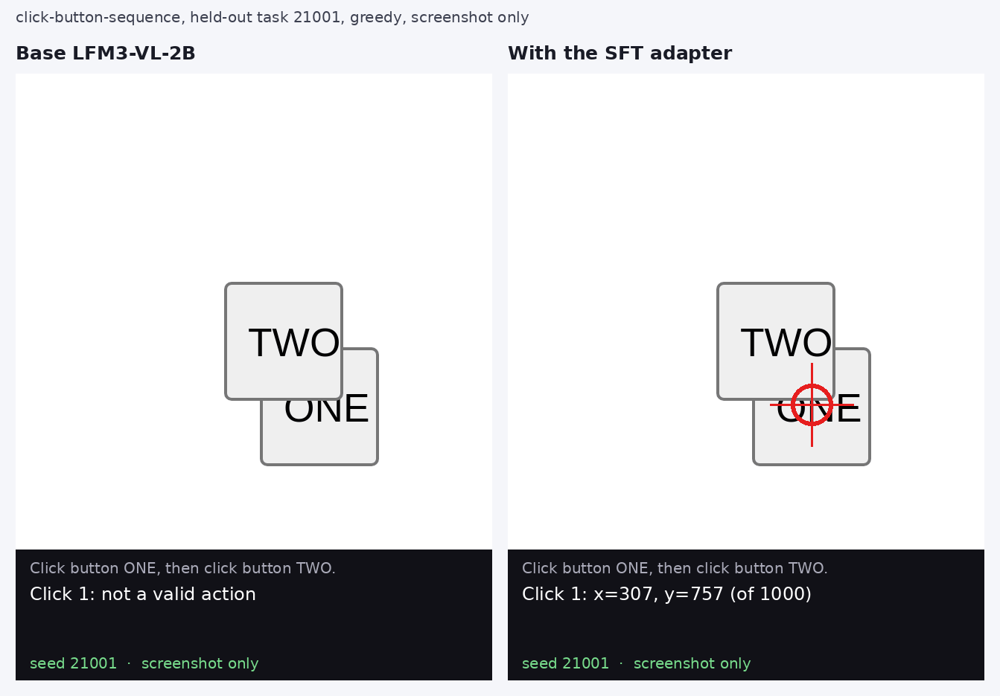
</p>

**GRPO improves sampled action validity.** Under sampling, 78 of 100 episodes ended on a malformed call. Among episodes
with valid calls throughout, 95% succeeded. Output formatting remained a common source of failure, and sampled episodes
varied in reward, providing a learning signal for GRPO.

I used a simplified GRPO over whole episodes. For each of the same 120 training tasks it samples 4 episodes, scores each
only by the task's own reward, and weights every turn of an episode by that episode's reward minus its group's mean. That's
one on-policy update per group, with no clipping, KL penalty or standard-deviation scaling. Then a second locked
evaluation on 100 fresh tasks (seeds 22000–22099), against the SFT adapter:

| Policy | Sampled (locked test) | Every call valid, sampled | Greedy | White image |
| --- | --- | --- | --- | --- |
| SFT | 26/100 | 30 | 91/100 | 0/100 |
| **SFT, then GRPO** | **83/100** (95% CI 75–89%) | **94** | **92/100** | 0/100 |

GRPO won 57 tasks and lost none under sampling (exact sign test, p ≈ 1e-17). On the same cohort, greedy success was
91/100 before GRPO and 92/100 afterward. Neither adapter completed a sequence with white-image inputs.

Sampled episodes with valid calls throughout increased from 30/100 to 94/100. Within those subsets, success was 26/30
(86.7%) before GRPO and 83/94 (88.3%) afterward. The improvement therefore appears to come largely from more reliable
output formatting. These subsets contain different episodes, so the conditional rates do not isolate changes in
visual decision quality.

<p align="center">
  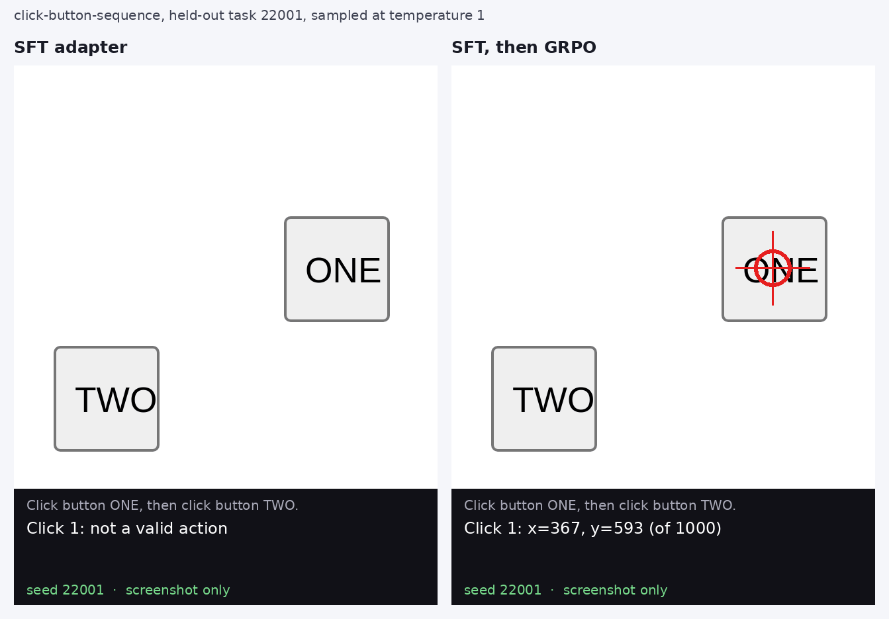
</p>

**What this does and doesn't show.** It's one MiniWoB task family with at most four clicks, not general computer use.
Both comparisons above are replays of the recorded held-out episodes, the same ones the numbers count.

**One click first.** Before the sequence, I trained a one-click adapter on
[`click-color`](https://miniwob.farama.org/environments/click-color/) ("click the cyan box"). On 100 reserved tasks it
went from 30 to 100 successes against the base model, but the base model already picked the right box in 30 of its 31
valid calls, so that gain is mainly the call format. A GRPO adapter matched it, but solved 6 of 100 tasks on white
images, above my declared limit of 5, so I don't claim it. The sequence adapter started from the one-click adapter, which
on its own solved 1 of 40 development sequences: it had the format, and it learned the sequence.

### LFM3-VL-2B before training

The untrained model already uses the pixels when it produces a valid call: on the one-click tasks it scored 0 of 120
on a white image. Its failures on real screenshots were mostly malformed calls, which the strict parser rejects. See the
[vision baseline](docs/results/lfm3-vision-baseline.md).

<p align="center">
  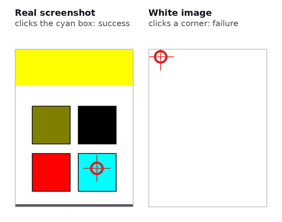
</p>

Base LFM3-VL-2B, greedy, on `click-color` task 30: the same prompt, with and without the pixels.

### LFM3-1.7B on [`book-flight`](https://miniwob.farama.org/environments/book-flight/)

The agent has to fill in origin and destination through autocomplete, work a read-only date picker, search, and book
the cheapest or shortest of the flights shown, on the `book-flight-nodelay` variant. The base model completed 0/100
tasks under evaluation settings requiring exactly one tool call per turn, with thinking disabled, a limit of 128
generated tokens per response and a strict action parser. In 97 of the 100 episodes the last turn was prose reasoning that reached the 128-token cap
before any call. On separate development probes, which start the model at a known step, 105 of 120 calls were
well-formed but only 24 matched an action that reaches that step's outcome; with thinking on and 512 tokens per turn it
was 32 of 120. The counts are in the evidence dataset (`lfm3-book-flight/base-gate.json`,
`lfm3-book-flight/development-diagnostic.json`), and `scripts/verify_reported_numbers.py` recounts each of them.

On the same 30 development tasks used for adapter selection (seeds 70–99), the base model completed 0/30 tasks and the
SFT adapter completed 25/30 under identical evaluation settings. The following replay shows one of those tasks:

<p align="center">
  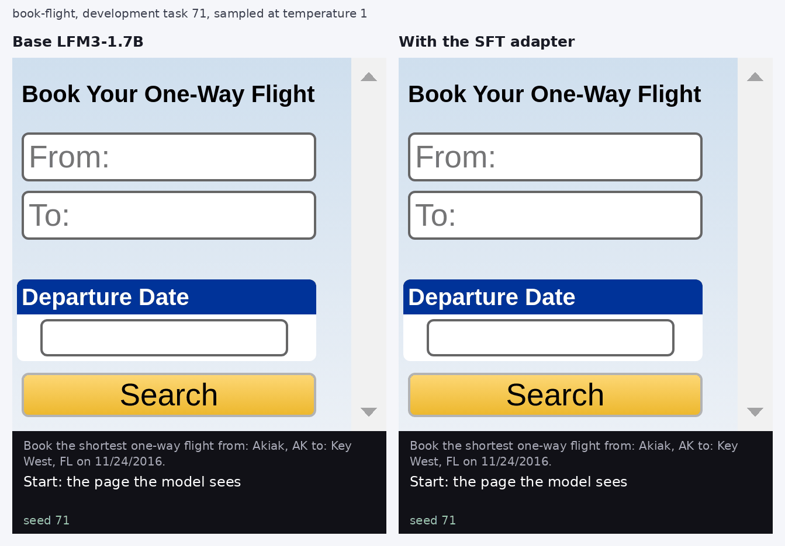
</p>

These are development tasks, so this pairing illustrates the difference rather than estimating it. The held-out number
is the next paragraph's.

An SFT adapter trained on traces from a scripted solver then succeeded on 160 of 200 reserved tasks, which were
evaluated once, after the policy and decoder were locked. All 1,823 tool calls were well-formed, and 21 of them failed in
the browser, in 3 episodes. Most failures come at the final step: the agent reached the results page in 197 episodes and
booked correctly in 160. In 35 of the 40 failures it chose a flight visibly worse than the best one shown, and "shortest"
goals failed more often (28 of 105) than "cheapest" (12 of 95).

<p align="center">
  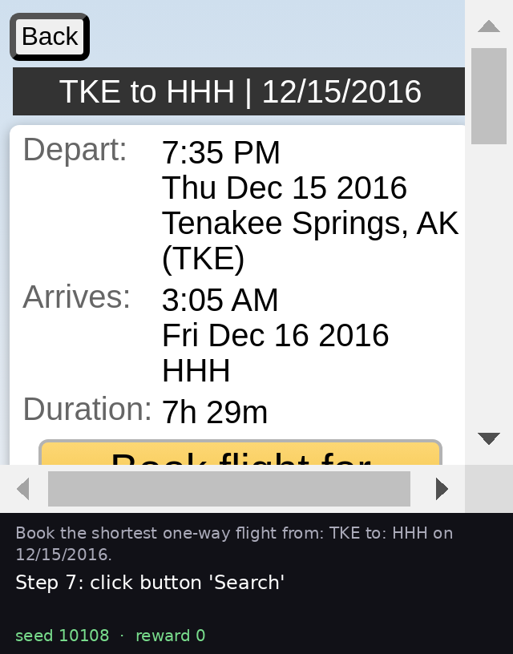
</p>

A typical failure, reserved task 10108: the shortest flight, 7h 29m, is the first one listed, and the agent booked the
10h 41m flight further down instead. The form was filled correctly; the comparison went wrong.

**What this does and doesn't show.** This is an estimate for one policy on one task family: simulated flights in
MiniWoB, under a sampling decoder at temperature 1 with `top_p` .95. The 0/100 and 160/200 used different seed ranges and
attention implementations, so they aren't a paired comparison. Policy selection used development tasks 70–99, which were reused across candidates, so the
development scores are not held-out estimates. Only the reserved number is.

### Book-flight GRPO

An earlier 24-group run from a weaker SFT checkpoint changed development success from 20/30 to 21/30. This small change
does not establish an improvement. Temperature and some training tasks were selected after inspecting variation probes;
those choices and the run details are recorded in the [book-flight methods](docs/lfm3-book-flight.md).

Before training the final SFT checkpoint further, I checked whether sampled episodes differed in reward. Each of 12
fresh tasks was sampled four times: six tasks at temperature 1.25 with top-p 0.95, and six at temperature 1 without
truncation. All four episodes in each group had the same reward, leaving no group-relative learning signal in these
samples. Training did not proceed from the final checkpoint.

### LFM2-350M on [`click-test`](https://miniwob.farama.org/environments/click-test/)

This is the easy one, and its limit matters: `click-test` has a single fixed prompt, and a formatting curriculum was
active while the model first learned. It shows reproducible alignment to a strict action format, not generalization.
See the [three-seed report](docs/results/phase5-three-seed-reproducibility.md).

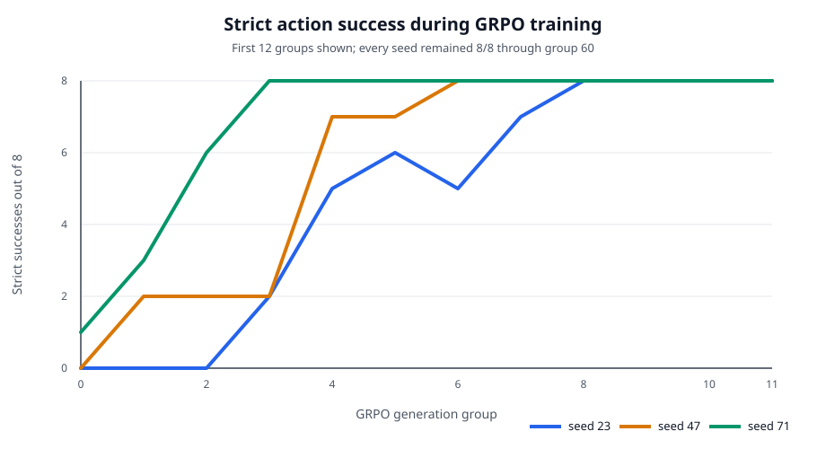

## Models and evidence

| Repository | Contents |
| --- | --- |
| [`Aptheos/lfm3-vl-2b-click-sequence-sft`](https://huggingface.co/Aptheos/lfm3-vl-2b-click-sequence-sft) | The click-sequence SFT adapter, the SFT-then-GRPO adapter (`sft-then-grpo/`, 83/100 sampled), and the one-click `click-color` adapter they started from |
| [`Aptheos/lfm3-1.7b-book-flight-sft`](https://huggingface.co/Aptheos/lfm3-1.7b-book-flight-sft) | The 160/200 adapter, and a second-seed replica for corroboration |
| [`Aptheos/lfm2-350m-click-test-grpo`](https://huggingface.co/Aptheos/lfm2-350m-click-test-grpo) | Three GRPO adapters, seeds 23, 47 and 71 |
| [`Aptheos/lfm-browser-control-evidence`](https://huggingface.co/datasets/Aptheos/lfm-browser-control-evidence) | Raw reports with every episode, the expert corpus and screenshots |

The main results can be recounted offline from individual episodes, with no model or GPU. The script's bundle hash is
pinned, so an edit to any listed report or screenshot fails:

```bash
uvx --from huggingface_hub hf download Aptheos/lfm-browser-control-evidence --repo-type dataset --local-dir evidence
python scripts/verify_reported_numbers.py --evidence evidence
```

The [evidence index](docs/evidence-index.md) maps each claim to its file and lists what isn't recounted.

## How it's built

A few design choices carry most of the weight:

- **The browser runs inside the training process.** [`local_browsergym.py`](src/browser_control/local_browsergym.py)
  runs Chromium and MiniWoB++ in the same Python process as the model, with no Docker and no environment server. That's
  what makes free Colab and Kaggle notebooks enough, and it keeps every task exactly reproducible from its seed. It's
  modelled on OpenEnv's BrowserGym wrapper ([`openenv/browsergym_env`](https://huggingface.co/spaces/openenv/browsergym_env),
  BSD-3-Clause), rewritten around this project's smaller interface.
- **One strict action contract per model.** LFM3 answers in its native tool-call format, LFM2 in a one-line
  `click('id')`, and LFM3-VL with a click tool whose coordinates run 0–1000 across the screenshot. Each has a strict
  parser and no repair, so format failures are counted, not hidden.
- **Multi-turn screenshot episodes.** The vision model gets a fresh screenshot each turn plus its earlier clicks as text
  ([`vision_evaluation.py`](src/browser_control/vision_evaluation.py)).
- **Two GRPO paths.** Single-step tasks use TRL's `GRPOTrainer` with a custom rollout function. Whole multi-turn
  episodes use a small group-relative trainer of my own ([`vision_sequence_grpo.py`](src/browser_control/vision_sequence_grpo.py)),
  because the reward only arrives when the episode ends.
- **Experts the environment checks.** Book-flight traces come from a scripted solver. Vision labels are chosen by the
  task itself: click-color by which box the scorer rewards, click-sequence by the browser's own hit test, so a covered
  button is never labelled, and a sequence is kept only if the scorer rewards it.
- **Held-out seeds locked in code.** The evaluator refuses reserved task seeds unless a locked protocol file names the
  exact seeds, model hash and decoder, and each report records that file's hash.
- **Controls built in.** Every vision evaluation can swap the screenshot for a white image, and training and evaluation
  share one decoder definition.
- **Replays, not recordings.** [`render_episode_replay.py`](scripts/render_episode_replay.py) redraws any recorded
  episode by resetting its seed and reapplying its actions, and fails if the reward differs.
  [`render_side_by_side.py`](scripts/render_side_by_side.py) puts two models on the same task next to each other.
- **Numbers anyone can recount.** [`verify_reported_numbers.py`](scripts/verify_reported_numbers.py) recounts the
  reported results from raw episodes in the evidence dataset, using only the standard library, and fails if any file
  has changed.

## Running it

Tests and lint need only the CPU and [uv](https://docs.astral.sh/uv/):

```bash
uv sync --python 3.11
uv run pytest
uv run ruff check .
```

Without the GPU extras, 22 tests that need PyTorch, TRL, NumPy or Pillow are skipped.

[Reproducing the results](docs/reproducing.md) has the GPU commands, including a 30-task check of the published adapter.
On 2–3 November I reran the LFM3 adapter check and the LFM2 commands from a clean copy: both adapters scored 25/30 again, and LFM2 reached
50/50 again.

**Pinned versions.** The ML stack is pinned to the versions the results were produced with: PyTorch, Transformers, TRL,
PEFT, Accelerate, Pillow, Playwright and BrowserGym. Some of those pins have published security advisories, mostly for
Pillow's image decoders and Transformers' loaders. That's acceptable for local research runs on trusted inputs (MiniWoB's
own pages and Liquid AI's checkpoints), but don't reuse these pins in a service that handles untrusted images or
model files. Supporting packages without a bearing on the numbers are kept current.

## Evaluation rules

- **Invalid output stays a failure.** A strict parser rejects malformed calls; nothing repairs them or retries.
- **Native reward only.** Success is the environment's terminal reward, with no shaping or oracle in evaluation.
- **Reserved tasks were used once.** The policy hash, decoder and task list were locked first, and no threshold or second attempt was involved.
- **GRPO masks are checked.** Browser observations are context and receive zero policy gradient, checked on the real model in a one-update run. See the [book-flight protocol](docs/lfm3-book-flight.md).
- **An element-ID control.** Consistently renumbering page IDs moved no skill by more than 1 of 20 probes, which is weak evidence against ID memorisation.

## Related work

Liquid AI's cookbook trains LFM2-350M on MiniWoB++ `click-test` with GRPO through TRL and OpenEnv
([example](https://github.com/Liquid4All/cookbook/tree/main/examples/browser-control),
[write-up by Pau Labarta Bajo](https://paulabartabajo.substack.com/p/fine-tuning-lfm2-350m-for-browser)), and names
`book-flight` and vision models as next steps. This project measures that `click-test` result across seeds and takes both natural
next steps, with held-out evaluation.

## Repository guide

| Path | Purpose |
| --- | --- |
| `src/browser_control/` | Environments, parsers, rollouts, evaluation and trainers |
| `scripts/` | Training, evaluation, contract checks, and the offline verifier |
| `tests/` | Unit, parser and trainer contract tests |
| `docs/` | Protocols and [result reports](docs/results/), including [LFM3 click-test](docs/results/lfm3-click-test.md) |
| `notebooks/` | Records of the July LFM2 runs on Colab |
| `docs/media/` | Episode replays rendered by `scripts/render_episode_replay.py` |

## License

The code is [MIT](LICENSE). The adapters are derived from Liquid AI's models and carry the `lfm1.0` licence, including
its commercial threshold; see each model card.
